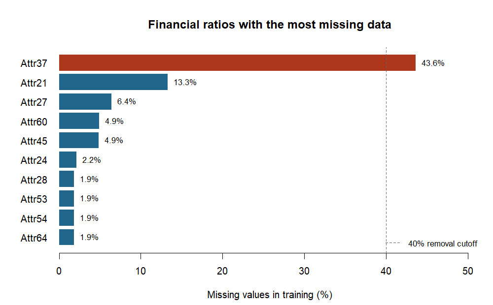
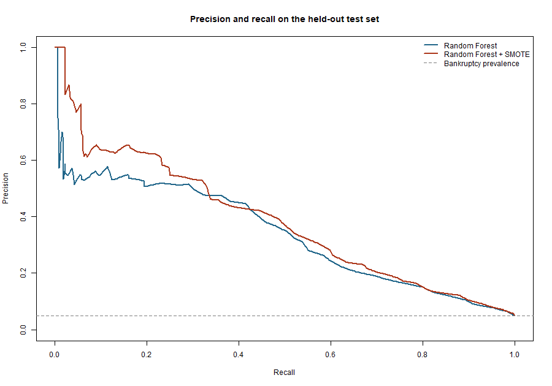

# Bankruptcy Prediction in R

An academic CRISP-DM project on predicting bankruptcy from Polish companies' financial statements. It compares a Random Forest trained on the original class distribution with one trained using SMOTE. Across the five source files, 2,091 of 43,405 statements are labeled bankrupt.

## Run the project

Download the [Polish Companies Bankruptcy dataset](https://archive.ics.uci.edu/dataset/365/polish+companies+bankruptcy+data) from the UCI Machine Learning Repository. Put `1year.arff` through `5year.arff` in `data/`. The dataset is credited to Sebastian Tomczak and distributed under CC BY 4.0.

Install the required packages once in R.

```r
install.packages(c("farff", "caret", "mice", "smotefamily", "randomForest", "pROC", "PRROC"))
```

From the project root, run the pipeline. It creates `outputs/` with the split counts, validation threshold searches, test metrics, charts, and the R session information.

```sh
Rscript --vanilla run.R
```

The pipeline was checked with R 4.5.2. The generated `outputs/session_info.txt` records the exact package versions used by each run.

### Run in RStudio

1. Open [Bankruptcy-Prediction-Portfolio.Rproj](Bankruptcy-Prediction-Portfolio.Rproj). In the **Files** pane, you should see `run.R`, `scripts/`, and `data/` once the inputs are in place.
2. Use the **Console** to install any missing packages using the command above. Then open `run.R` from **Files** and click **Source** in the editor. Wait for the Console to print the final metrics and return to the `>` prompt.
3. In **Files**, open `outputs/` and click `missing_values_top10.png`, then `precision_recall_curve.png`. The scripts save PNGs directly to disk. Open the results in RStudio's data viewer with `View(read.csv("outputs/test_metrics.csv"))`.

## Walk through the scripts

1. **Load and split.** [Script 01](scripts/01_load_and_split.R) combines the five files and records the forecast horizon. In this dataset, `1year.arff` describes a five-year horizon and `5year.arff` describes a one-year horizon. The script groups rows whose 64 original ratios are identical before making an approximately 60/20/20 split. Training fits the models, validation chooses cutoffs, and test estimates how the chosen rules perform on held-out rows.
2. **Prepare the predictors.** [Script 02](scripts/02_preprocess.R) uses training rows to drop ratios with over 40% missing values, remove constant ratios, and filter strongly correlated ratios using a 0.9 cutoff. For the remaining gaps, MICE starts from training medians and cycles through the incomplete columns. Predictive mean matching fills each gap with an observed training value from a row with a similar predicted value. Holdout rows can receive imputations. Only training rows fit the imputation models and supply donor values. The bankruptcy label is absent from all imputation inputs.
3. **Train and choose thresholds.** [Script 03](scripts/03_train_and_tune.R) trains two 100-tree forests. A forest's score is the share of trees voting for bankruptcy. For the second forest, SMOTE interpolates between nearby bankruptcy examples in training. It uses training-scaled ratios for neighbour distances and generates examples within each forecast horizon. Each forest's threshold is chosen on validation by maximizing F1 over the same grid. F1 is the harmonic mean of precision and recall.
4. **Evaluate.** [Script 04](scripts/04_evaluate.R) prepares and scores the test rows after the models and thresholds are set. It compares the usual 0.50 cutoff with the validation-selected cutoff for each forest. Recall measures how many actual bankruptcy cases were caught. Precision measures how many flagged cases were actually bankrupt. ROC AUC and PR AUC summarize the scores across cutoffs. The dashed line in the precision–recall plot marks the bankruptcy prevalence in the test set.

## Missing values before imputation

`Attr37` exceeded the 40% missingness cutoff in the training set. The pipeline drops it and imputes gaps in the retained ratios.



## Held-out results

The test set contains 8,673 statements, including 419 labeled bankrupt. The validation-selected thresholds were 0.20 for the baseline and 0.35 for SMOTE.

| Model | Cutoff | Bankruptcy cases caught | Recall | Precision | F1 |
| --- | ---: | ---: | ---: | ---: | ---: |
| Random Forest | 0.50 | 33 / 419 | 7.9% | 55.0% | 0.138 |
| Random Forest + SMOTE | 0.50 | 93 / 419 | 22.2% | 62.0% | 0.327 |
| Random Forest | 0.20 | 192 / 419 | 45.8% | 38.1% | 0.416 |
| Random Forest + SMOTE | 0.35 | 172 / 419 | 41.1% | 42.9% | 0.420 |

ROC AUC was 0.862 for the baseline and 0.871 with SMOTE. PR AUC was 0.339 and 0.382, respectively. The tuned baseline caught more bankruptcy cases. The tuned SMOTE model flagged fewer non-bankrupt cases, with 229 false positives compared with 312 for the baseline.



## Limits

Exact matching keeps identical financial-ratio vectors together. The ARFF files provide no company identifier, so different statements from the same company could still land in separate partitions. The results measure held-out row performance on this dataset. The forests produce classification scores and the project does not test probability calibration.
